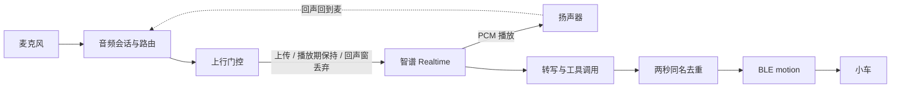
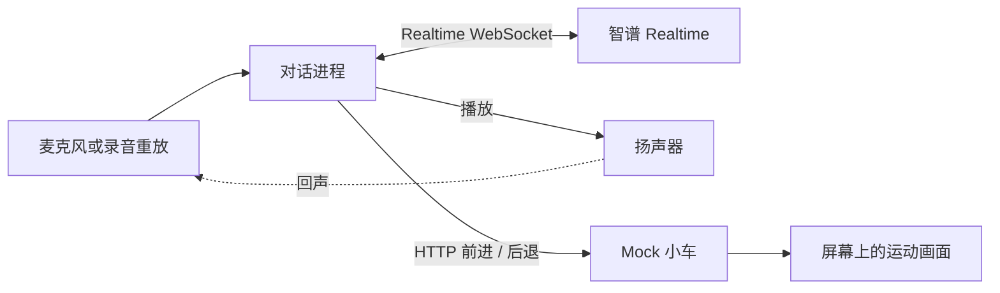
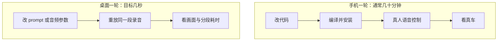

# 桌面智谱 Realtime 仿真方案

本文记录 KARI iOS 迭代里的一项建议：先在电脑上用同一套智谱（Zhipu / GLM）Realtime 模型做桌面仿真，把「改参数 → 看到结果」从几十分钟压到几秒，再把经验带回手机。

本仓库是 iOS 客户端。机器人固件在独立仓库，协议仍是现有 BLE 的 `motion` / `stop`。桌面仿真应放在一个新的 Git 仓库里。本文只描述方案，不在本仓库实现该程序，也不改动 App 代码。

## 背景

最新版本的 iOS KARI APP 在手机上使用智谱实时模型做语音控制时，效果不理想。

当前研发流程是：用户把 APP 上的问题告诉 Cursor，Cursor 改代码，用户把新版本装到手机，再实际发语音控制小车。不满意就再走一遍。从改代码到看到结果要经过编译、安装和真机操作，一轮往往要几十分钟，提示词、音频路由和检测参数没法快速试。

## 问题分析

手机上同时看到三件事：自己的声音被自己听见、前进口令经常不执行、对话显得笨且慢。三者表现不同，共同卡住的是反馈环路。瓶颈主要不在「换一个更大的模型」，而在改代码、装机、真人测这一圈太长，无法对同一段声音反复比较 prompt 和音频参数。下面按现象展开，原因都是待仿真验证的假设，依据是本客户端里已经存在的音频门控、智谱会话和动作去重。

### 共同根因：反馈环路太长

一轮典型路径是改 Swift 或提示词、编译安装、连上小车、对着麦克风说、看车动不动、再凭记忆描述现象。中间没有可重复的输入。同一句「前进」每次的音量、距离、扬声器回声和蓝牙时延都不一样，所以分不清是模型没听清、工具没调用、去重丢掉了，还是车收到了但脉冲太短。

桌面仿真要先打破的就是这一圈：固定一段录音，改一处参数，几秒后同时看到转写、工具调用、Mock 车是否移动，以及各段耗时。模型仍用同一套智谱 Realtime，变的是观察速度。

### 回声回归

APP 自己说的声音会被自己听到。这个问题前面已经处理过，这次调整后又出现。回声进模型之后，服务端会把播放内容当成用户插话，打断当前回复，或把助手刚说过的话再识别成口令。

本客户端里和回声相关的现成机制包括：

- 麦克风和播放共用一个 `AVAudioEngine`。播放期间上行不直接丢弃，而是进入「保持本地回合」；一轮结束后约 0.45 秒的回声窗内才丢弃上行。
- 智谱会话使用服务端 VAD，`interrupt_response` 打开，静音阈值约 0.15，静音时长 700 ms。`input_audio_buffer.speech_started` 会清掉正在播放的缓冲。
- 可恢复的服务端错误（含 VAD、ASR、commit、buffer）会把回声窗再推后约 0.45 秒，连接保持不断。

因此「曾经好、这次又响」更像参数或路由回退，而不是模型突然变了。待查的可能原因：

1. **音频会话和路由。** 听筒、外放、有线耳机和蓝牙之间切换后，播放声回到麦克风的电平和延迟都变了。原先按某一种路由调好的门控，换路由就盖不住。
2. **回声抑制窗。** 0.45 秒只盖播放结束后的尾巴。扬声器较大、房间反射较长，或播放缓冲还没真正排空时，尾音仍会进入上行。
3. **VAD 与打断。** 阈值偏低、且允许打断回复时，播放声本身就能触发 `speech_started`，形成「自己说、自己打断」。
4. **播放期上行策略。** 播放中改为继续上传（为了保留真人插话）之后，若本地没有足够的回声消除，扬声器声会重新进模型。丢弃过宽又会把真人插话一起丢掉，两条边界要一起看。
5. **参数回退。** 后续改动若把抑制窗、VAD 阈值或「播放期是否上传」改回旧值，已修复的回声会原样回来。桌面上应把这几项做成可切换开关，用同一段「只放不说」的录音确认。

### 命令识别不准

让小车前进时，有时完全不动，同一句话要重复很多次才前进一次。

当前口令不是单一路径。服务端转写到达后，本地会用 `scenario(for:)` 把「前进 / 往前走 / turn right」等说法收成场景名；智谱另外还有 `drive(direction)`，方向枚举是「前进、后退、左转、右转」。转写快路径和工具调用都能发起动作。两秒内同名动作会被 `claimMotion` 丢掉，注释里把它视为同一次口令的回声，而不是新命令。

待查的可能原因：

1. **转写或工具调用不稳定。** 同一句有时只有转写、有时只有 `drive`、有时两者都没有。只说话不调工具时，车不会动；提示词虽然要求这四个方向优先调工具、少加口头答应，模型仍可能只回复语音。
2. **中英说法和场景映射。** 快路径认的是一组中英短语，`drive` 只接受四个中文枚举。说法落在两者之间（例如带了步数、语气词，或中英夹杂）时，可能被判成闲聊，或工具参数无法解析。
3. **去重和防抖。** 两秒窗口会吃掉紧接着的第二次「前进」。用户觉得「说了很多次才动一次」时，有可能第一次已经执行但脉冲只有约 300 ms、看不出来，第二次又被当成回声丢掉。回声修复和命令去重共用「短时间同名即丢弃」这一假设，收紧回声时容易误伤重复口令。
4. **提示词。** 人格说明、相机开关插入的指令、以及「不要只用语音回答」这几段叠在一起。小的措辞变化就会让模型从「立刻 `drive`」变成「先聊天」。没有固定录音就无法对比。
5. **音频质量。** 回声门控、播放期保持、低电平麦克风，都会让上行里有效语音变短或变脏。服务端 VAD 切段不准时，commit 出去的是半句，工具自然不稳定。

桌面上应用同一段「前进」录音反复跑：记录转写文本、是否出现 `drive` 或场景名、是否被两秒窗口丢弃、Mock 车是否移动。四列对齐之后，才能判断该改 prompt、映射、去重还是上行音频。

### 不够智能、交互差、响应慢

对话显得不够聪明，来回不自然，从说完到车动或听到回复要等很久。慢和「笨」经常被说成一件事，但它们落在不同段上。

待查的可能原因：

1. **往返延迟没有拆开。** 一段体感延迟里叠着采集、上行、服务端 VAD 的 700 ms 静音、模型首包、24 kHz 播放预缓冲、工具执行和 BLE 确认。手机上只能感到「慢」，看不到慢在哪一段。
2. **视频模式的负载。** 关闭相机时智谱会话是 `audio`，不上传画面；打开相机后变为 `video_passive` 并附带 JPEG。视频帧改变提交方式、负载和计费，也会改变模型「要不要先描述画面」。语音控制小车的试验若混在视频模式里，交互和时延都会变差。
3. **无效重试。** ASR、VAD、commit、buffer 一类错误被当成可恢复：连接保持，只推迟回声窗并提示可以继续说。对用户这像卡住或答非所问，日志里却是一轮被取消后又在同一条连接上继续。
4. **缺少分段计时。** 现有追踪能看到电平、上传帧数和部分服务端事件类型，还不能把「用户说完 → 首个音频包 → 开始播放 → 工具调用 → BLE 确认」画成一条时间线。没有这条线，调 prompt 和调缓冲会互相掩盖。

智能程度本身（会不会追问、会不会误动、会不会只聊天）仍取决于提示词和工具约束。桌面仿真的价值是让同一段对话可以重放：改提示词后立刻对比工具是否被调用、回复是否更短、首包晚了多少毫秒。

## 桌面仿真方案

在一个新的 Git 仓库里做桌面仿真，范围只覆盖 Realtime 用法和「听到口令 → 车动」这条链：

- 新开 Git 仓库，不放进本 iOS 仓库，也不改固件。
- 电脑上接入同样的智谱 Realtime 模型，会话形态与手机侧语音模式对齐（PCM、服务端 VAD、`drive` 与场景工具）。
- Mock 一个小车程序，只模拟前进和后退。
- 对话程序与 Mock 小车通过 HTTP 接口联通：识别到方向后发请求，Mock 程序更新状态。
- 电脑上能看到小车前进或后退的画面。
- 先在桌面完成 Realtime API 用法、提示词和音频参数的仿真，再把对照结果应用到本 iOS APP。真车协议和电机参数留到手机验证。

建议的最小闭环：

1. 对话进程负责麦克风、播放、Realtime WebSocket，以及回声门控、VAD 参数、提示词这几个开关。
2. Mock 进程提供 `POST /drive`，只接受前进和后退，并在窗口里移动一个方块。
3. 每次试验写入一行记录：录音标识、转写、工具名、是否被去重、HTTP 状态、各段毫秒数。
4. 支持重放同一段录音，避免每次都重新对着麦克风说。

## 数据流

下面三张图用 Mermaid 描述。预览若不渲染 Mermaid，用每张图后面的文本图。

### 当前 iOS APP

麦克风进音频会话，经上行门控后进入智谱 Realtime。模型下行有两条：语音回到扬声器（这里产生回声），以及转写和工具调用。工具与转写汇合后做两秒同名去重，再经 BLE 发给小车。回声、命令丢失和体感延迟分别标在对应节点上。



```text
麦克风 → 音频会话/路由 → 上行门控 → 智谱 Realtime
                              ↑              │
                              └── 扬声器回声 ←┘ 播放
智谱 Realtime → 转写/工具调用 → 两秒同名去重 → BLE → 小车

回声：扬声器 → 路由 → 门控 → Realtime
命令：转写/工具 → 去重 → BLE
延迟：麦 → Realtime → 播放或 BLE 的整段
```

### 桌面仿真

对话进程替换手机上的音频与工具执行，智谱仍在云端。动作不再走 BLE，改为 HTTP 通知 Mock 小车，画面在本机更新。回声仍可能从扬声器回到麦克风，但路由简单，参数可以当场改。



```text
麦克风或录音重放 → 对话进程 ↔ 智谱 Realtime
                      │  └→ 扬声器 →（回声）→ 麦克风
                      └→ HTTP 前进/后退 → Mock 小车 → 画面
```

### 反馈环路

手机一轮要重新编译、安装、真机说话才能看到真车。桌面一轮只改 prompt 或音频参数，重放同一段录音，看画面和分段耗时。



```text
手机：改代码 → 编译安装 → 真人语音 → 看真车        （几十分钟）
桌面：改 prompt/音频参数 → 重放同一段录音 → 看画面和耗时 （几秒）
```

## 评估与局限

该方案可行，对准的是三个问题的共同根因：反馈环路从几十分钟收成几秒之后，提示词和音频参数才能被反复试验。

- **回声。** 在桌面直接切换音频路由和 VAD、回声窗、播放期是否上传。用「只播放、人不说话」的录音确认模型还会不会听到自己。
- **指令。** 反复喂同一段「前进」录音，对比不同 prompt、映射和去重窗口，看哪一列从「不调用」变成「稳定调用」。
- **响应。** 按采集、上行、模型首包、播放、HTTP 动作分段计时，先去掉视频模式，再决定要不要在手机上缩短某一段。

局限也明确。iOS 的 `AVAudioSession`、语音处理、外放与蓝牙路由，以及 BLE 确认和真车脉冲，桌面无法一比一模拟。Mock 画面只能说明「口令已经变成一次前进或后退」，不能说明电机时长、方向校准或丢包。桌面上得到的参数和提示词，最终仍要回到手机上验证。那时已经是带着对照记录做精修，而不是在真机上盲调。
